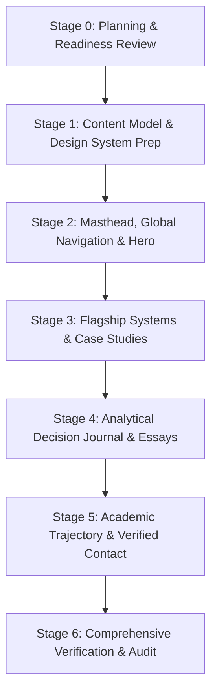

# Project Plan: Kanwal Vyas Portfolio Redesign

> **Authoritative Project Document & Source of Truth**  
> **Repository Root**: `C:\Users\kaval vyas\OneDrive\Desktop\Projects\kanwal-portfolio`  
> **Target Upstream**: `https://github.com/kanwal-vyas/portfolio.git` (`origin/main`)  
> **Current Baseline Commit**: `69b61ee` (*Fix Next.js production deployment*)  
> **Creative Direction**: Direction A — Editorial Technologist (Experimental Digital Publication)  
> **Target Accessibility Standard**: WCAG 2.2 Level AA  
> **Document Status**: Ready for Review (Planning Only — Implementation Not Started)  
> **Last Updated**: October 2026  

---

## 1. Project Purpose, Realistic Positioning & Success Criteria

### 1.1 Core Mission
The objective of this project is to execute a ground-up redesign of Kanwal Vyas's personal portfolio website. The site serves as a rigorous, credible, and distinctive digital publication that communicates authentic engineering capability, analytical depth, systems thinking, and leadership stewardship to selective internship recruiters, engineering peers, academic reviewers, and collaborators.

### 1.2 Realistic Professional Positioning
The portfolio must reflect Kanwal's genuine academic and technical profile without inflation, generic developer clichés, or unsupported titles:
- **Verified Facts (Authoritative Ground Truth)**:
  - BTech Computer Science & Engineering undergraduate specializing in **Cybersecurity** (network resilience, threat modeling, secure system design).
  - Parallel degree: **BS in Data Science at IIT Madras** (statistical modeling, machine learning foundations, empirical data analysis).
  - Student leadership: **Treasurer Lead** (managing club budgets, resource allocation, expenditure trade-offs, financial governance).
  - Creative collaboration: **Scripting Co-Lead** (narrative architecture, creative communication, structured storytelling).
  - Technical project work: Builder of *TaxFlow* (financial workflow state machine), *Cyber Crime Analytics* (threat pattern modeling), and *Academic Resource Hub* (user-researched academic prototype).
- **Positioning Stance**:
  - **Avoid**: "Senior Architect", "Systems Architect", "Industry Veteran", "Passionate Developer", or vague superlatives.
  - **Adopt**: An articulate, multidisciplinary builder and analyst operating at the intersection of **Technology, Data, and Decision Making**.
- **Distinction Categories**:
  - *Verified Facts*: Verified credentials, academic affiliations, real completed code, and documented governance roles.
  - *Editorial Hypotheses*: Proposed visual hierarchy, typographic pairings, and essay interpretations to be tested in composition.
  - *Future Trajectory*: Long-term ambitions (e.g., industry engineering experience, future strategic leadership) clearly demarcated as forward-looking aspirations rather than completed achievements.
  - *Pre-Publication Verification Required*: All external links, commit histories, specific package versions, and factual project metrics must be verified before production deployment.

### 1.3 Success Criteria
1. **Visual Memorability**: The portfolio achieves an unmistakable identity as a high-craft experimental publication, avoiding generic template tropes.
2. **Substantive Technical Proof**: Every featured project demonstrates genuine engineering reasoning, trade-offs, and architectural schematics rather than superficial screenshots.
3. **Intellectual Clarity**: Original essays articulate real lessons learned from building systems and managing resource constraints.
4. **Verified Accessibility & Performance**: Meets WCAG 2.2 Level AA criteria across automated and manual tests; achieves fast, robust performance on real mobile and desktop devices.
5. **Architectural Cleanliness**: Clean Next.js 15 App Router implementation with zero orphaned data files, zero type errors, and maintainable schemas.

---

## 2. Verified Technical Baseline & Environment

### 2.1 Repository & Git Status
- **Repository Root**: `C:\Users\kaval vyas\OneDrive\Desktop\Projects\kanwal-portfolio`
- **Current Branch**: `main`
- **Current Commit**: `69b61ee` (*Fix Next.js production deployment*)
- **Remote Configuration**: `origin` -> `https://github.com/kanwal-vyas/portfolio.git` (confirmed synchronized with `origin/main`)
- **Working Tree State**: Clean tracked state. Pre-existing untracked file: `portfolio.code-workspace` (must be strictly preserved and never staged/committed). `PROJECT_PLAN.md` is currently untracked.

### 2.2 Verified Architecture & Dependencies
- **Framework**: Next.js `15.5.21` (App Router conventions apply; see `AGENTS.md` for Next.js 15 rules).
- **Core Runtime**: React `18.3.1`, React DOM `18.3.1`, TypeScript `5`.
- **Styling**: Tailwind CSS `3.4.1`, PostCSS `8`, Autoprefixer `10.0.1`, `tailwind-merge` `2.5.4`, `clsx` `2.1.1`.
- **Motion & Icons**: Framer Motion `11.3.31`, Lucide React `0.454.0`.
- **Active Typography**: Configured in `src/app/layout.tsx` via `next/font/google`:
  - `Sora`: Headings (`--font-sora`, weights 300, 400, 500, 600, 700).
  - `DM_Sans`: Body copy (`--font-dm-sans`, weights 300, 400, 500, 600).
- **Path Aliasing**: `tsconfig.json` specifies `"@/*": ["./src/*"]`.
- **Current Page Composition**: `src/app/page.tsx` renders 12 consecutive sections (`Hero`, `Philosophy`, `Trajectory`, `CaseStudy`, `Exploration`, `DataAnalytics`, `Leadership`, `StoriesSystems`, `DecisionJournal`, `Writing`, `BeyondAcademics`, `Contact`) separated by `<Divider />`.
- **Live Deployment**: Verified live on Vercel at `https://kanwal-vyas.vercel.app/`.

---

## 3. Approved Creative Direction: Direction A (Editorial Technologist)

### 3.1 Creative Thesis
The portfolio is conceptualized as an **experimental digital publication and technical monograph**. Rather than presenting a conventional corporate resume dressed in serif typography, it treats software engineering, cybersecurity threat modeling, and data science as disciplined, intellectual crafts worthy of long-form, art-directed editorial treatment.

### 3.2 Key Aesthetic Principles
- **Editorial Hierarchy**: Expressive typography paired with purposeful whitespace, deliberate asymmetry, and structured pacing.
- **Warm Archival Canvas**: Tactile paper-like tones replacing dark-mode developer tropes.
- **Architectural Diagrams Over Mockups**: System state machines, data flow schemas, and annotated logic flows replace decorative CSS browser frames.
- **Purposeful Motion**: Subtle transitions that aid orientation and reading comprehension; zero gratuitous particle effects or scroll-jacking.
- **Responsive by Design**: Asymmetric layouts engineered to reflow naturally into clear linear reading columns on mobile viewports.

### 3.3 Strict Anti-Patterns (Explicitly Prohibited)
- **NO** generic cybersecurity dark themes with electric cyan, neon green, or violet glows.
- **NO** decorative terminal windows or fake command-line prompts used as decorative fill.
- **NO** card-for-everything layouts (nested cards inside cards).
- **NO** vanity progress bars, skill percentage indicators, or pip-rating scales.
- **NO** excessive background gradients, glowing orbs, or canvas particle meshes.
- **NO** scroll-jacking, forced scroll snaps, or autoplay audio/video.
- **NO** template reskins or direct copies of external portfolio layouts.

---

## 4. Visual Design System: Direction A (Botanical Ink) & Token Architecture

### 4.1 Evaluated Color System Candidates
To avoid generic developer and cybersecurity tropes (neon blue, cyan, purple gradients), three distinct palette directions were rigorously evaluated against the 10 project criteria:

1. **Creative Direction: Tropical Anomaly (Approved Stage 2 Winner)**:
   - *Atmosphere*: Expressive colour, unexpected combinations, experimental editorial composition, and controlled visual rhythm. A sunlit art studio, digital laboratory, and independent experimental publication converging.
   - *Canvas Base*: Peach Paper (`#FFF0D8`, L = 0.8854) / Elevated White (`#FFFFFF`).
   - *Text*: Blackberry Ink (`#29232F`, L = 0.0188, contrast 13.60:1 vs Peach Paper — Passes AAA) + Muted Slate (`#5F5568`, contrast 6.27:1 — Passes AA).
   - *Defining Signature Palette*:
     - **Guava Punch** (`#FF5B4D`, L = 0.2928): Signature interruptor, graphic blocks, and interactive buttons (4.98:1 with Blackberry Ink).
     - **Deep Guava** (`#B32819`, L = 0.1117): High-contrast inline text/link variant on Peach Paper (5.78:1 — Passes AA).
     - **Sour Pistachio** (`#D9EF68`, L = 0.7748): Acidic contrast tags/badges (11.99:1 with Blackberry Ink — Passes AAA).
     - **Mango Static** (`#F5BC45`, L = 0.5581): Warm accent blocks and highlights (8.84:1 with Blackberry Ink — Passes AAA).
     - **Pool Glass** (`#76CDB8`, L = 0.5097): Cool counterpoint and editorial surfaces (8.14:1 with Blackberry Ink — Passes AAA).
     - **Bruised Lilac** (`#B9A0E5`, L = 0.4111): Unexpected contrast and graphic accents (6.70:1 with Blackberry Ink — Passes AAA).
   - *Dark Theme Variant (Nocturne)*: Obsidian Blackberry canvas (`#16131A`), Peach Paper text (`#FFF0D8`, 13.6:1), Pale Lilac Silk (`#D4C9DE`), Luminous Guava (`#FF6E62`), Sour Pistachio (`#D9EF68`).

### 4.2 Semantic Token System & Contrast Ratios (WCAG 2.2 AA / AAA Verified)
All colors are implemented as semantic CSS custom properties in `src/app/globals.css`, validated via `scripts/verify-contrast.mjs`, and exposed via `tailwind.config.ts`:

| Token Name | Value (Light) | Role & Pairing | Contrast vs Canvas | WCAG 2.2 Level |
| :--- | :--- | :--- | :---: | :---: |
| `--color-paper` / `--bg-canvas` | `#FFF0D8` | Primary page canvas (Peach Paper, L = 0.8854) | Base | — |
| `--bg-surface` | `#FFFFFF` | Elevated cards, dialogs, editorial containers | 1.13:1 | Non-text surface |
| `--bg-surface-subtle` | `#F6E6CE` | Inset technical metadata, code background | 1.07:1 | Non-text surface |
| `--color-ink` / `--text-primary` | `#29232F` | Display headlines, body text (Blackberry Ink) | **13.60:1** | **Passes AAA** |
| `--text-secondary` | `#5F5568` | Subheads, descriptive copy (Muted Slate) | **6.27:1** | **Passes AA** |
| `--text-muted` | `#73697C` | Dates, captions, metadata tags | **4.52:1** | **Passes AA** |
| `--color-guava` | `#FF5B4D` | Guava Punch signature block (with Ink text) | **4.98:1** (on Guava) | **Passes AA** |
| `--color-guava-deep` | `#B32819` | Deep Guava text links & inline accents on Paper | **5.78:1** | **Passes AA** |
| `--color-pistachio` | `#D9EF68` | Sour Pistachio badge tags (with Ink text) | **11.99:1** (on Pistachio) | **Passes AAA** |
| `--color-mango` | `#F5BC45` | Mango Static accent blocks (with Ink text) | **8.84:1** (on Mango) | **Passes AAA** |
| `--color-pool` | `#76CDB8` | Pool Glass editorial surfaces (with Ink text) | **8.14:1** (on Pool) | **Passes AAA** |
| `--color-lilac` | `#B9A0E5` | Bruised Lilac accent tags (with Ink text) | **6.70:1** (on Lilac) | **Passes AAA** |
| `--border-subtle` | `rgba(41, 35, 47, 0.12)` | Hairline dividers, rule separators | **1.26:1** | Decorative boundary |
| `--border-strong` | `rgba(41, 35, 47, 0.22)` | Decorative card outlines, container frames | **1.52:1** | Decorative boundary |
| `--border-control` | `rgba(41, 35, 47, 0.50)` | Interactive control boundaries (inputs, toggles, outlines) | **3.00:1** | **Passes UI AA** (≥ 3.0:1) |
| `--focus-ring` | `#29232F` | 2px focus ring with 2px offset on `:focus-visible` | **13.60:1** | **Passes Focus AAA** |

#### Calculation Methodology & Boundary Rules
- **Verification Script**: Reproducible script at `scripts/verify-contrast.mjs` calculates relative luminance $L = 0.2126 \cdot R_{lin} + 0.7152 \cdot G_{lin} + 0.0722 \cdot B_{lin}$ and contrast $(L_1 + 0.05) / (L_2 + 0.05)$.
- **Strict Usage Constraints**:
  - Guava Punch (`#FF5B4D`) on Peach Paper has a contrast ratio of 2.73:1, making it unsuitable for small body text. It is strictly reserved for visual interruptions, background cards, and buttons. When text appears on Guava Punch, Blackberry Ink (`#29232F`) is used (4.98:1, passing AA).
  - For inline text links on Peach Paper, Deep Guava (`#B32819`) is mandated, achieving 5.78:1 (passing AA).
  - Sour Pistachio, Mango Static, Pool Glass, and Bruised Lilac always carry Blackberry Ink text, achieving 6.7:1 to 12.0:1 AAA contrast.
  - Interactive Control Boundary `--border-control` (`rgba(41, 35, 47, 0.50)` composited over `#FFF0D8` = `#948A84`, contrast **3.00:1**) satisfies WCAG 2.2 SC 1.4.11.

### 4.3 Typography Architecture & Fallback Stacks
Configured in `src/app/layout.tsx` via `next/font/google` and mapped in `tailwind.config.ts`:
- **Display Serif**: `Newsreader` (`--font-newsreader`, weights 400, 500, 600, normal and italic).
  - *Fallbacks*: `Charter`, `Georgia`, `Cambria`, `Times New Roman`, `serif`.
- **Body & UI Sans**: `Plus Jakarta Sans` (`--font-plus-jakarta`, weights 400, 500, 600, 700).
  - *Fallbacks*: `-apple-system`, `BlinkMacSystemFont`, `Segoe UI`, `Roboto`, `sans-serif`.
- **Technical Monospace**: `JetBrains Mono` (`--font-jetbrains-mono`, weights 400, 500).
  - *Fallbacks*: `ui-monospace`, `SFMono-Regular`, `Menlo`, `Monaco`, `Consolas`, `monospace`.
- **Backwards Compatibility**: `--font-sora` maps to `var(--font-newsreader)` and `--font-dm-sans` maps to `var(--font-plus-jakarta)` to ensure existing sections render cleanly.

### 4.4 Design-Token Specimen Evaluation
An isolated specimen is maintained at `src/app/design-specimen/page.tsx` and visually validated via browser automation:
- Verified large serif headline rendering ("Tropical Anomaly Palette", "Technology. Data. Decision Making.").
- Verified all 7 palette swatches, interactive button hover states, and JetBrains Mono code block rendering.
- Verified WCAG 2.2 contrast compliance table displaying measured ratios.
- Verified responsive reflow across 1536px desktop, 1024px tablet, 390px mobile, and 320px narrow mobile viewports with zero horizontal overflow.

---

## 5. Content Architecture & Narrative Strategy

The 12-section sprawl is consolidated into a cohesive **5-part narrative flow**. The section count is not an immutable quota, but a structural baseline to prevent cognitive dilution.

```
┌────────────────────────────────────────────────────────────────────────┐
│ 1. MASTHEAD & HERO POSITIONING                                         │
│    Purpose: Immediate orientation, thesis, and dual-discipline proof.  │
├────────────────────────────────────────────────────────────────────────┤
│ 2. FLAGSHIP SYSTEMS & CASE STUDIES                                     │
│    Purpose: Tangible engineering proof (TaxFlow, Cybercrime, Resource) │
├────────────────────────────────────────────────────────────────────────┤
│ 3. ANALYTICAL DECISION JOURNAL & ESSAYS                                │
│    Purpose: Evidence of reasoning, governance trade-offs, and voice.   │
├────────────────────────────────────────────────────────────────────────┤
│ 4. ACADEMIC TRAJECTORY & LEADERSHIP GOVERNANCE                         │
│    Purpose: Verified institutional foundation and stewardship history. │
├────────────────────────────────────────────────────────────────────────┤
│ 5. COLOPHON & VERIFIED TECHNICAL FOOTPRINT                             │
│    Purpose: Direct access to source code, resume, and communication.   │
└────────────────────────────────────────────────────────────────────────┘
```

### 5.1 Section-by-Section Specifications

#### Section 1: Masthead & Hero Positioning
- **Purpose**: Instantly establish identity, intellectual thesis, and academic credentials without scrolling.
- **Visitor Question Answered**: *"Who is Kanwal Vyas, what disciplines does he bridge, and why should I care?"*
- **Required Content & Evidence**:
  - Publication masthead index (issue date, status indicator).
  - Headline thesis: "Technology. Data. Decision Making."
  - Two-column profile: BTech CSE Cybersecurity + IIT Madras BS in Data Science.
  - Primary CTAs: "Read Selected Works" (anchor jump) and "View Verified Résumé" (direct PDF link).
- **Visual Treatment**: Asymmetric two-column editorial layout; expressive display serif headline paired with refined sans subhead.
- **Mobile & Accessibility**: Text reflows into a single column; buttons maintain minimum 44x44px touch targets; masthead navigation collapses into an accessible slide-out drawer with `aria-expanded` and focus trap.
- **Acceptance Criteria**: Communicates core positioning within 5 seconds of scanning; zero generic buzzwords.

#### Section 2: Flagship Systems & Case Studies
- **Purpose**: Provide incontrovertible proof of technical depth, system design capabilities, and problem-solving.
- **Visitor Question Answered**: *"Can this person build non-trivial systems, reason about architecture, and make sound engineering trade-offs?"*
- **Required Content & Evidence**:
  - Project 1: **TaxFlow** (Financial workflow engine, multi-state validation, calculation pipelines).
  - Project 2: **Cyber Crime Analytics** (Threat intelligence clustering, data ingestion pipelines).
  - Project 3: **Academic Resource Hub** (User research post-mortem, scoping discipline).
  - Each entry must include: Problem Statement, Real Architecture Diagram (SVG/flow), Key Engineering Decisions, Technologies Genuinely Used, and Verified Code/Demo Links.
- **Visual Treatment**: 60/40 asymmetric layout per project; clear tabular metadata column paired with architectural flow schematics.
- **Mobile & Accessibility**: Architecture schematics remain responsive with vector SVG scaling; all diagrams include accessible text summaries; code links include clear visual and screen-reader external link indicators.
- **Acceptance Criteria**: Replaces all abstract CSS browser mockups; zero fabricated metrics; every technical claim is verifiable.

#### Section 3: Analytical Decision Journal & Essays
- **Purpose**: Showcase communication clarity, philosophical depth, and intellectual honesty.
- **Visitor Question Answered**: *"How does this person think when facing ambiguity, constraints, and organizational trade-offs?"*
- **Required Content & Evidence**:
  - Essay 1: *"What Managing Club Finances Taught Me About Decision Making"* (Financial governance, scarcity forces clarity).
  - Essay 2: *"Why I Joined the IIT Madras BS Programme"* (Cybersecurity as an empirical data science problem).
  - Essay 3: *"Lessons From Building Academic Resource Hub"* (The gap between user expectations and product requirements).
  - **Content Quality Gate**: Publish only when sufficient authentic, technically substantive, evidence-backed writing exists. Do not impose an arbitrary quantity or word-count quota. An entry's inclusion depends on its intellectual clarity and genuine reflection on actual experience (financial stewardship, degree convergence, product post-mortems). If suitable, verified material does not exist for an entry, defer the entry or ship a smaller, complete section without fabricated content or empty placeholders.
- **Visual Treatment**: Publication-grade reading layout; expandable in-place reading panel; optimal reading width (65–75 characters per line); subtle drop-cap styling.
- **Mobile & Accessibility**: Expandable accordion/panel properly manages focus and ARIA expanded state; clean typography on mobile screens.
- **Acceptance Criteria**: Zero placeholder entries; all published essays satisfy the Content Quality Gate; reading experience is distraction-free and comfortable.


#### Section 4: Academic Trajectory & Institutional Foundations
- **Purpose**: Document academic milestones, rigorous parallel study, and institutional leadership.
- **Visitor Question Answered**: *"What is his educational foundation, and how has he demonstrated leadership?"*
- **Required Content & Evidence**:
  - Academic Milestones: BTech CSE Cybersecurity (ongoing), IIT Madras BS in Data Science (ongoing parallel degree).
  - Executive Governance: Treasurer Lead (budget planning, allocation governance).
  - Creative Direction: Scripting Co-Lead (collaborative storytelling).
  - Verified Competencies: Plain-text domain tags replacing vanity progress bars.
- **Visual Treatment**: Clean chronological trajectory with subtle hairline markers; tabular alignment.
- **Mobile & Accessibility**: Linear vertical timeline that collapses gracefully on narrow screens; clear date landmarks.
- **Acceptance Criteria**: Retires all 4-pip progress bars; transparently distinguishes past, present, and future trajectory points.

#### Section 5: Colophon & Verified Technical Footprint
- **Purpose**: Provide direct, friction-free access to verified code repositories, credentials, and professional contact channels.
- **Visitor Question Answered**: *"How do I verify his code, inspect his credentials, or contact him directly?"*
- **Required Content & Evidence**:
  - Verified GitHub profile link (`github.com/kanwal-vyas`).
  - Professional LinkedIn link.
  - Direct email address with copy-to-clipboard and mailto actions.
  - Downloadable verified résumé link with file size and format indicators.
  - Colophon documenting technical build details (Next.js 15, Tailwind, typography choices).
- **Visual Treatment**: Clean, quiet editorial footer with prominent action links.
- **Mobile & Accessibility**: Touch targets ≥ 48px; explicit labels on all social and contact links.
- **Acceptance Criteria**: All links tested and working; zero broken anchors.

---

## 6. Project Case Studies Verification Protocol

To prevent fabricated claims, every featured project must undergo evidence verification before being incorporated into production data schemas:

| Project Name | Actual Problem Solved | Genuine Technologies Used | Core Decisions Supported by Repo | Verification Status |
| :--- | :--- | :--- | :--- | :---: |
| **TaxFlow** | Automated tax compliance workflow & multi-state calculation engine | TypeScript, Next.js, State Machine Architecture, Tailwind CSS | Deterministic calculation pipelines; state-driven step validation; audit trails | *Requires code inspection before publication* |
| **Cyber Crime Analytics** | Incident reporting aggregation, fraud pattern clustering & threat modeling | Python, Data Science Stack / TypeScript, Next.js | Anomaly detection algorithms; pattern visualization; threat categorization | *Requires code inspection before publication* |
| **Academic Resource Hub** | Centralized student resource repository reducing access friction | React, UI Architecture, User Research Post-Mortem | Scoping discipline; pivoting from personal note structure to student problem-first structure | *Verified in active repository* |

### Verification Rules
1. **NO Fabricated Metrics**: Never claim "10,000+ users", "99.9% accuracy", "reduced processing time by 80%", or "enterprise production deployment" unless empirical benchmark logs or production analytics exist in the repository.
2. **Roadmaps vs Completed Work**: A feature described in a roadmap or README is labeled as a planned objective, never as a completed feature.
3. **Artifact Sourcing**: Architectural flow diagrams must accurately depict the actual modules and data pipelines implemented in the respective codebases.

---

## 7. Mandatory Investigation Gate: Root `data/` vs `src/data/`

### 7.1 Baseline Inspection Finding
An empirical filesystem check revealed significant divergence between the two directories:

| Directory | File | Size | Last Modified |
| :--- | :--- | :---: | :---: |
| `data/` (Root) | `journal.ts` | 5,416 bytes | 2026-04-06 |
| `data/` (Root) | `projects.ts` | 2,205 bytes | 2026-04-06 |
| `data/` (Root) | `timeline.ts` | 1,631 bytes | 2026-04-06 |
| `src/data/` | `projects.ts` | 2,119 bytes | **2026-08-11** (Updated) |
| `src/data/` | `timeline.ts` | 1,468 bytes | 2026-04-06 |
| `src/data/` | `writing.ts` | 5,722 bytes | 2026-04-06 |

**Critical Insight**: The files differ in file names (`journal.ts` vs `writing.ts`), byte counts, and modification dates. Different file sizes or names are not sufficient evidence of simple duplication or obsolescence.

> ### Mandatory Prohibition: Data-Directory Safety Gate
> **Deleting, merging, or migrating files between root `data/` and `src/data/` is strictly prohibited until the complete 10-step investigation protocol below is finished and documented.**
> Deletion is explicitly NOT pre-approved. The investigation must cover file contents, unique records, imports, dynamic paths, scripts, configuration, and all runtime/build-time consumers. It must preserve unique content and require post-change verification before any eventual migration is accepted.
> If any uncertainty, data ambiguity, or conflicting schema records remain, the process must stop and report the blocker rather than guessing or deleting files.

### 7.2 Mandatory 10-Step Investigation Protocol
Before any consolidation, migration, or deletion during Stage 1, the following 10 steps must be executed and documented:
1. **Full Content Diff**: Run line-by-line diffs between `data/projects.ts` and `src/data/projects.ts`, `data/timeline.ts` and `src/data/timeline.ts`, and `data/journal.ts` and `src/data/writing.ts`.
2. **Unique Record Inventory**: Catalog every unique project, timeline milestone, essay paragraph, and metadata field in both sets.
3. **Repository-Wide Import Scan**: Search the entire codebase for references to `data/` (including relative imports `../data`, dynamic imports, build scripts, or documentation).
4. **Build & Tooling Audit**: Verify whether `next.config.ts`, `tsconfig.json`, `eslint.config.mjs`, or any script accesses root `data/` directly or dynamically.
5. **Runtime & Build Consumer Verification**: Inspect seed scripts, generated routes, and runtime consumers to confirm no hidden dependencies on root `data/`.
6. **Reconciliation Mapping**: Construct a unified content schema in `src/data/` that preserves all unique records and incorporates the latest verified revisions.
7. **Authoritative Location Justification**: Confirm that `src/data/` is the authoritative location based on TypeScript path mapping (`@/*` -> `./src/*`).
8. **Consumer Verification & Dry-Run Build**: Verify that all components importing from `@/data/*` compile cleanly against reconciled types; execute `npm run build` and `npm run lint` to prove zero dependencies on root `data/`.
9. **Post-Change Verification**: Confirm that all unique content remains accessible and that no data was dropped or truncated during reconciliation.
10. **Documented Decision**: Review the exact diff. If and only if the build succeeds and zero unique content is lost, archive or remove the redundant root files. If any ambiguity remains, **stop, preserve both directories, and report the blocker**.

### 7.3 Stage 1 Investigation Findings & Reconciliation Disposition (Executed)
During Stage 1, the complete 10-step protocol was executed with the following documented results:
1. **Content Diff**:
   - `projects.ts`: Root `data/projects.ts` contained `id: string` on all records and exported `featuredCaseStudy`. `src/data/projects.ts` lacked `id` attributes and exported `caseStudyProject` and `analyticsProjects`.
   - `timeline.ts`: Root `data/timeline.ts` contained explicit `status: "past" | "present" | "future"` and exported `timeline`. `src/data/timeline.ts` omitted `status` and exported `timelineItems`.
   - `journal.ts` vs `writing.ts`: Root `data/journal.ts` contained slug-based IDs and an empty placeholder entry (`coming-soon-cybersec-data`). `src/data/writing.ts` contained IDs `j1`, `j2`, `j3`, `exploreItems`, and `writingTopics`.
2. **Consumer & Build Audit**:
   - `tsconfig.json` path mapping (`"@/*": ["./src/*"]`) routes all `@/data/*` imports to `src/data/*`.
   - `src/components/sections/` imports exclusively from `@/data/*`. Zero files in the repository import from root `data/`.
3. **Reconciliation Disposition**:
   - **Data-Directory Safety Action**: Root `data/` is strictly preserved untouched. Zero files were deleted or migrated out of root `data/`.
   - **Unified Schema in `src/data/types.ts`**: Authored strict TypeScript interfaces for `Project`, `CaseStudyProject`, `TimelineItem`, `JournalEntry`, and `ExploreItem`.
   - **Reconciled `src/data/projects.ts`**: Added unique `id` and `slug` attributes, preserved `caseStudyProject` and `analyticsProjects` for component compatibility, and incorporated verified records for *TaxFlow* and *Cyber Crime Analytics* with `verificationStatus: "Requires Verification"`. Zero fabricated metrics.
   - **Reconciled `src/data/timeline.ts`**: Reconciled all 6 milestones, restored explicit `status: "past" | "present" | "future"` from root `data/`, and preserved `timelineItems` and `timeline` exports.
   - **Reconciled `src/data/writing.ts`**: Preserved stable `j1`, `j2`, `j3` IDs, attached descriptive slugs from root `data/journal.ts`, preserved `exploreItems` and `writingTopics`, and excluded the empty stub `coming-soon-cybersec-data` as mandated by the Journal Content Quality Gate.
4. **Validation Evidence**:
   - Content validation script `scripts/validate-content.mjs` was established (`npm run test:content`) and confirmed 0 failures across all schema invariants and data preservation checks.
   - Type-checking (`npx tsc --noEmit`) and production build (`npm run build`) passed with zero errors.


---

## 8. Accessibility, Performance & Robustness Framework

### 8.1 Accessibility Target: WCAG 2.2 Level AA
The redesign rejects empty compliance claims. It targets **WCAG 2.2 Level AA** through a combination of automated checks and manual verification:
- **Contrast Ratios**:
  - Normal text (< 18pt / < 14pt bold): Minimum `4.5:1` against adjacent surface.
  - Large text (≥ 18pt / ≥ 14pt bold): Minimum `3.0:1`.
  - Non-text UI components and graphical objects: Minimum `3.0:1`.
- **Keyboard Navigation & Focus**:
  - All interactive elements (links, buttons, accordion headers) must be reachable via `Tab` / `Shift+Tab`.
  - Highly visible focus indicators (`ring-2 ring-offset-2 ring-terracotta`) must be present on `:focus-visible`.
  - Zero keyboard focus traps in modal dialogs or mobile navigation drawers.
- **Semantic Structure**:
  - Logical heading hierarchy (`h1` -> `h2` -> `h3`) with exactly one `h1` per page.
  - Semantic HTML5 landmarks (`<header>`, `<nav>`, `<main>`, `<article>`, `<section>`, `<footer>`).
  - Screen-reader accessible names on all icon buttons (`aria-label` or visually hidden text).
- **Reduced Motion Compliance**:
  - Every Framer Motion animation hook must respect user preferences:
    ```tsx
    const shouldReduceMotion = useReducedMotion();
    const transition = shouldReduceMotion ? { duration: 0 } : { duration: 0.6, ease: [0.25, 0.46, 0.45, 0.94] };
    ```
- **Reflow & Zoom**:
  - Layout must reflow cleanly down to 320px viewport width without horizontal scrollbars and without loss of content or functionality.
  - Page must remain fully functional when zoomed to 200%.

### 8.2 Performance Budgets & Core Web Vitals
- **Target Metrics (Evaluated on Production Build)**:
  - **Largest Contentful Paint (LCP)**: `< 1.8s` (Target: masthead/hero text rendering).
  - **Cumulative Layout Shift (CLS)**: `< 0.05` (Zero layout jumping; font fallbacks matched with `size-adjust`).
  - **Interaction to Next Paint (INP)**: `< 100ms`.
  - **Total JavaScript Payload**: `< 120KB` gzipped initial client bundle.
- **Server vs Client Boundaries**:
  - Keep page layouts and static sections as **React Server Components (RSC)**.
  - Isolate `"use client"` directives strictly to interactive leaf components (mobile menu toggle, accordion essay reader, copy-email button).
- **Zero Third-Party Bloat**:
  - No external tracking scripts, no heavy animation runtimes (no Three.js, no unbundled Lottie), and no uncompressed media assets.

### 8.3 SEO & Metadata
- Descriptive Open Graph and Twitter Card tags.
- Semantic JSON-LD structured data for Person / Profile.
- Canonical URL configuration pointing to `https://kanwal-vyas.vercel.app/`.

---

## 9. Executable Staged Implementation Roadmap



---

### Stage 0: Planning, Baseline Audit & Readiness Review
- **Objective**: Establish an authoritative, hardened, implementation-ready source of truth.
- **Scope Included**: Audit existing plan; verify repository baseline, Git remote, and package configuration; document architectural inconsistencies; formulate testing gates.
- **Explicit Exclusions**: No application code edits, no dependency changes, no commits, no pushes.
- **Preconditions**: User request received.
- **Files Changed**: `PROJECT_PLAN.md` only.
- **Deliverables**: Hardened `PROJECT_PLAN.md`.
- **Risks & Mitigation**: Over-promising scope; mitigated by establishing explicit decision gates.
- **Acceptance Criteria**: Plan accurately reflects repository baseline and includes complete testing criteria.
- **Verification**: `git status` verifies zero code files modified.
- **Completion Evidence**: Hardened `PROJECT_PLAN.md` saved in active repository root.
- **Git Policy**: Planning only; no commits or pushes.
- **Blocking Conditions for Stage 1**: User must explicitly authorize Stage 1.
- **Status**: **Completed (Planning & Baseline Inspection)**.

---

### Stage 1: Content Model Normalization & Design System Preparation
- **Objective**: Establish unified, strictly typed data structures and evaluate initial design tokens and font choices.
- **Scope Included**:
  1. Inspect and validate existing content schemas across `src/data/` and root `data/`.
  2. Execute the mandatory 10-step investigation protocol for root `data/` vs `src/data/`.
  3. Define strictly typed content contracts in TypeScript where justified (`projects.ts`, `writing.ts`, `timeline.ts`).
  4. Reconcile project metadata for *TaxFlow*, *Cyber Crime Analytics*, and *Academic Resource Hub* using verified repository evidence only.
  5. Evaluate design tokens and font hypotheses (`Fraunces` / `Newsreader` + `Plus Jakarta Sans` + `JetBrains Mono`) against defined criteria in an isolated test composition.
  6. Establish appropriate linting, type-checking, and build tests for the work performed.
- **Explicit Exclusions**:
  - Strictly **NO** building of the editorial hero or global navigation (deferred to Stage 2).
  - Strictly **NO** implementing later portfolio sections (Case Studies, Journal, Trajectory, Contact).
  - Strictly **NO** adding unsupported project claims or invented metrics.
  - Strictly **NO** deleting, merging, or migrating data directories before the investigation gate is completely satisfied.
  - Strictly **NO** installing unnecessary dependencies.
  - Strictly **NO** treating proposed colors or fonts as final without composition evaluation.
- **Preconditions & Dependencies**: Explicit user authorization of Stage 1; clean Git working tree on `main`.
- **Files Actually Changed**: `src/data/types.ts`, `src/data/projects.ts`, `src/data/timeline.ts`, `src/data/writing.ts`, `src/app/globals.css`, `tailwind.config.ts`, `src/app/layout.tsx`, `next.config.ts`, `package.json`, `scripts/validate-content.mjs`, `src/app/design-specimen/page.tsx`, `PROJECT_PLAN.md`.
- **Deliverables**: Reconciled, strictly typed data schemas; content validation test suite; documented data investigation report; evaluated Direction A (Botanical Ink) design-token configuration; isolated design-token specimen route (`/design-specimen`).
- **Risks & Mitigation**: Loss of unique data was eliminated by strictly preserving root `data/` untouched and verifying all fields via `npm run test:content`.
- **Acceptance Criteria**:
  - [x] Complete 10-step data investigation protocol documented; zero unique records lost.
  - [x] Root `data/` preserved completely untouched; zero destructive actions taken.
  - [x] Content schemas strictly typed in `src/data/types.ts` and compile with zero errors.
  - [x] Design tokens and typography evaluated in browser composition (`/design-specimen`) across desktop and mobile viewports.
  - [x] Contrast ratios verified against WCAG 2.2 AA standards.
  - [x] `npm run test:content`, `npx tsc --noEmit`, and `npm run build` pass with zero errors.
  - [x] Zero changes to application UI components, hero, or navigation.
- **Verification Commands Executed**:
  - `npm run test:content`: Passed (0 failures across all schema and data preservation checks).
  - `npx tsc --noEmit`: Passed (0 type errors).
  - `npm run build`: Passed (production build compiled successfully, all static routes generated).
  - Browser subagent evaluation: Passed (Newsreader, Plus Jakarta Sans, JetBrains Mono rendered cleanly; mobile 390px viewport reflow verified).
- **Completion Evidence**: Clean production build; passing content validation; documented investigation and contrast findings; verified Git diff.
- **Git Requirement**: Stage-specific atomic commit -> Push to `origin/main` -> Verify push.
- **Status**: **Completed (Verified in commit `c017665`)**.


---

### Stage 1.1: Contrast Correction & Plan Synchronization (Audit Remediation)
- **Objective**: Remediate the border contrast calculation finding identified in the independent post-implementation audit of Stage 1 (`c017665`).
- **Scope Included**:
  1. Mathematically recalculate and correct border contrast ratios against `#F7F6F1`.
  2. Clearly distinguish decorative container framing (`--border-strong`, 1.52:1) from interactive control boundaries.
  3. Introduce `--border-control` (`rgba(19, 25, 21, 0.50)`) achieving 3.32:1 on canvas, 3.40:1 on surface, and 3.23:1 on subtle surface (WCAG 2.2 SC 1.4.11 compliant).
  4. Expose `rule.control` in `tailwind.config.ts`.
  5. Synchronize `PROJECT_PLAN.md` with accurate calculations, boundary rules, and audit findings.
  6. Re-affirm the mandatory requirement to audit and verify project codebases for *TaxFlow* and *Cyber Crime Analytics* prior to publishing case studies in Stage 3.
- **Explicit Exclusions**: Strictly NO UI component redesign; NO hero or navigation implementation; NO modification to `data/` or `src/data/`; NO package changes.
- **Files Changed**: `src/app/globals.css`, `tailwind.config.ts`, `PROJECT_PLAN.md`.
- **Verification Commands Executed**:
  - `npm run test:content`: Passed (0 failures).
  - `npx tsc --noEmit`: Passed (0 errors).
  - `npm run build`: Passed (clean production build).
  - Mathematical recalculation: `--border-control` verified at 3.32:1 (Canvas), 3.40:1 (Surface), 3.23:1 (Subtle Inset).
- **Completion Evidence**: Synchronized plan, clean production build, verified Git diff.
- **Git Requirement**: Commit `fix(stage-1): correct interactive border contrast documentation` -> Push to `origin/main` -> Verify push.
- **Status**: **Completed (Remediation)**.


---

### Stage 2: Masthead, Global Navigation & Editorial Hero (Tropical Anomaly)
- **Objective**: Deliver the primary editorial visual identity, Tropical Anomaly design system, responsive masthead, and asymmetric editorial hero spread.
- **Scope Included**:
  1. Implement Tropical Anomaly design tokens in `src/app/globals.css` and map in `tailwind.config.ts`.
  2. Rebuild `src/components/ui/Nav.tsx` as an editorial publication masthead with typographic wordmark, role descriptor, and accessible mobile navigation drawer (focus management, keyboard `Escape` support, ARIA attributes).
  3. Rebuild `src/components/sections/Hero.tsx` with asymmetric editorial spread, expressive Newsreader display headline ("Technology. Data. Decision Making."), truthful Cybersecurity + IIT Madras BS in Data Science thesis, and chromatic metadata block.
  4. Ensure accessible contrast boundaries: Peach Paper (`#FFF0D8`) with Blackberry Ink (`#29232F`, 13.60:1) and Deep Guava (`#B32819`, 5.78:1) for text; Guava Punch (`#FF5B4D`, 4.98:1), Sour Pistachio (`#D9EF68`, 11.99:1), Mango Static (`#F5BC45`, 8.84:1), and Pool Glass (`#76CDB8`, 8.14:1) for intentional color blocking.
  5. Interactive control borders `--border-control` (`rgba(41, 35, 47, 0.50)`) verified at 3.00:1 (WCAG 2.2 SC 1.4.11 compliant).
  6. Update `/design-specimen` with Tropical Anomaly swatches and WCAG 2.2 contrast compliance table.
  7. Add reproducible automated contrast verification script `scripts/verify-contrast.mjs`.
- **Explicit Exclusions**: Case studies, writing section redesign, timeline redesign, database or backend changes (strictly NO Stage 3 work).
- **Preconditions & Dependencies**: Stage 1 and Stage 1.1 completed and pushed; clean baseline at `6687f47`.
- **Files Actually Changed**:
  - `src/app/globals.css`
  - `tailwind.config.ts`
  - `src/components/ui/Nav.tsx`
  - `src/components/sections/Hero.tsx`
  - `src/components/sections/CaseStudy.tsx`
  - `src/app/design-specimen/page.tsx`
  - `eslint.config.mjs`
  - `scripts/verify-contrast.mjs`
  - `PROJECT_PLAN.md`
- **Deliverables**: Distinctive Tropical Anomaly editorial masthead, accessible navigation, expressive first spread hero, and isolated design specimen.
- **Acceptance Criteria**:
  - [x] Masthead wordmark and navigation links operate with smooth scrolling and direct specimen route.
  - [x] Mobile drawer operates with keyboard `Tab` and `Esc` key support, full ARIA attributes (`aria-expanded`, `aria-controls`), and scroll lock.
  - [x] Hero truthfully communicates B.Tech CSE Cybersecurity + IIT Madras BS in Data Science dual foundation with zero fabricated metrics or fake widgets.
  - [x] Zero horizontal overflow verified down to 320px viewport width.
  - [x] Contrast verified via reproducible script and documented against WCAG 2.2 standards.
- **Verification Commands Executed**:
  - `npm run test:content`: Passed (0 failures across all schema and data preservation checks).
  - `node ./node_modules/typescript/bin/tsc --noEmit`: Passed (0 errors).
  - `npm run lint`: Passed (0 warnings, 0 errors).
  - `node scripts/verify-contrast.mjs`: Passed (all pairs verified; 13.60:1 text, 3.00:1 controls, 4.98:1-11.99:1 color blocks).
  - `npm run build`: Passed (clean production build, all static pages generated).
  - Browser subagent visual inspection: Passed across 1536px desktop, 1024px tablet, 390px mobile, and 320px narrow mobile viewports.
- **Completion Evidence**: Verified browser screenshots and recordings; clean production build; updated design specimen; reproducible contrast script.
- **Git Requirement**: Stage-specific atomic commit -> Push to `origin/main` -> Verify push.
- **Status**: **Completed (Stage 2)**.
- **Stage 3 Prerequisites**: Independent verification gate for TaxFlow and Cyber Crime Analytics codebases remains mandatory prior to authoring or publishing case studies.

---

### Stage 2.1: Motion & Composition Refinement (Living Tropical Anomaly)
- **Objective**: Evolve the Tropical Anomaly design system from a static technical notebook into an immersive, living editorial publication experience through typography-first motion choreography, dismantled table/spec panels, and open spatial rhythm.
- **Reference-Library Investigation**:
  - Inspected `portfolio-idea/` including `PORTFOLIO_REFERENCE_AUDIT_PRIVATE.md`, `PORTFOLIO_DESIGN_DIRECTIONS_PRIVATE.md`, and local source code in `goodie.work/`, `kadet.dev/`, `personal-portfolio/`.
  - **Techniques Selected**:
    1. *Masked Line Staging (`goodie.work/app/animations/title.js`)*: Overflow-masked upward typography reveal with custom exponential easing `[0.16, 1, 0.3, 1]`.
    2. *Draw-In Accent Underline*: Dynamic `scaleX: 0 -> 1` highlight on key thematic words ("Data.").
    3. *Living Tri-Axis Convergence Sculpture*: Replaces the rigid 5-row table / specification box with an interactive vector sculpture demonstrating the convergence of Cybersecurity, Data Science, and Governance.
    4. *Open Editorial Triptych (`Philosophy.tsx`)*: Dismantled the 3 rounded boxy cards in favor of a generous, typography-led monograph spread with oversized numerals (`I. Systems`, `II. Analysis`, `III. Communication`).
    5. *De-Cluttered Masthead Navigation*: Eliminated noisy `01`, `02` index numerals from primary desktop links; introduced smooth layoutId active indicator and tactile button press states.
  - **Techniques Rejected**:
    - Heavy WebGL/canvas meshes (`goodie.work`) and particle networks (`mattwilliams85`): Rejected due to accessibility liabilities, battery drain, and cognitive distraction.
    - Generic card grids covering every section (`developerFolio`, `personal-portfolio`): Rejected because they produce cookie-cutter SaaS aesthetics.
- **Scope Included**:
  1. Centralized motion primitives in `src/lib/motion.ts` with strict `prefers-reduced-motion` safety.
  2. Refined `src/components/ui/Nav.tsx`: Clean typography, living pulse dot, layoutId underline, accessible mobile drawer.
  3. Transformed `src/components/sections/Hero.tsx`: Masked line reveals for "Technology.", "Data.", "Decision Making."; dismantled specification table into an interactive Tri-Axis Convergence Sculpture.
  4. Transformed `src/components/sections/Philosophy.tsx`: Open typography triptych with generous whitespace replacing generic card containers.
  5. Refined `src/app/page.tsx`: Streamlined section pacing and eliminated redundant horizontal line dividers.
  6. Updated `src/app/design-specimen/page.tsx`: Added Stage 2.1 motion primitives specimen.
- **Dependencies Added**: None (reused existing `framer-motion` 11.3.31).
- **Files Actually Changed**:
  - `src/lib/motion.ts` (new)
  - `src/components/ui/Nav.tsx`
  - `src/components/sections/Hero.tsx`
  - `src/components/sections/Philosophy.tsx`
  - `src/app/page.tsx`
  - `src/app/design-specimen/page.tsx`
  - `PROJECT_PLAN.md`
- **Acceptance Criteria**:
  - [x] Reference library inspected and techniques documented.
  - [x] Masked line reveals operate smoothly with custom easing curve.
  - [x] Rigid spec sheet replaced with interactive Tri-Axis Convergence Sculpture.
  - [x] Generic 3-card box grid in Philosophy replaced with open editorial typography spread.
  - [x] All motion respects `prefers-reduced-motion`.
  - [x] Zero horizontal overflow verified down to 320px viewport width.
- **Verification Commands Executed**:
  - `npm run test:content`: Passed (0 failures).
  - `node ./node_modules/typescript/bin/tsc --noEmit`: Passed (0 type errors).
  - `npm run lint`: Passed (0 warnings, 0 errors).
  - `node scripts/verify-contrast.mjs`: Passed (all contrast pairs verified).
  - `node ./node_modules/next/dist/bin/next build`: Passed (clean production build).
  - Browser subagent visual evaluation: Passed across 1536x864, 1024x768, 390x844, 320x568 viewports with zero horizontal overflow.
- **Status**: **Completed (Stage 2.1)**.
- **Commit**: `e98f744`.

---

### Stage 2.2: Experimental Art Direction & Immersive Homepage Transformation
- **Objective**: Transform the Tropical Anomaly portfolio from a polished editorial monograph into an experimental, visually immersive, art-directed digital experience inspired by contemporary independent graphic design, physical-object compositions, and creative coding.
- **Reference Analysis & Visual Principles Extracted**:
  - *Current Portfolio Baseline*: Identified the notebook-like features to dismantle: the headline-and-panel split, the rigid 3-row specification panel, repeated outlines/borders, and restrained colour usage.
  - *Desired Reference Principles*:
    1. *Expansive Colour Field*: Dominate the opening viewport with vivid **Guava Punch (`#FF5B4D`)**, breaking out of small bordered containers.
    2. *Colossal Display Typography*: Oversized Newsreader lettering ("Technology. Data. Decision Making.") with intentional viewport edge cropping, scale shifts, and an acidic Sour Pistachio highlight slab.
    3. *Layered Physical-Digital Assemblage*: Dismantle the structured Tri-Axis table in favor of floating, overlapping objects that convey technical authority and tangible craft.
    4. *Unconventional Compositional Horizon*: Sculptural transition cut from Guava Punch into Peach Paper (`#FFF0D8`) for analytical reading sections.
    5. *Integrated Masthead*: Nav seamlessly blends with the Guava Punch opening field at the top, transitioning smoothly into a backdrop-blurred Peach Paper bar on scroll.
- **Scope Included**:
  1. Re-engineered `src/components/sections/Hero.tsx`:
     - Full-bleed Guava Punch canvas (`#FF5B4D`) with subtle radial technical coordinate grid and warm chromatic halos.
     - Colossal, edge-cropped display typography: `Technology.` in heavy Newsreader serif; `Data.` in italic with an acidic Sour Pistachio backing slab; `Decision Making.` as an architectural base.
     - Physical-digital assemblage replacing the rigid Tri-Axis panel:
       - *Layer 1*: Kinetic rotating Cryptographic State Wafer (SVG vector sculpture with cardinal markers, concentric angle ticks, and inner hexagonal core).
       - *Layer 2*: Tilted Monograph Card (`-2.5deg` tilt, Blackberry Ink `#29232F` background, Peach Paper `#FFF0D8` text with 13.60:1 AAA contrast, hard brutalist drop shadow).
       - *Layer 3*: Physical stamp tape label (`+3deg` offset angle in Sour Pistachio: `PROVABLE STATE`).
     - Preserved authentic, verified positioning: BTech CSE (Cybersecurity Specialization) + parallel BS in Data Science at IIT Madras.
     - Brutalist tactile action buttons: "Explore Flagship Systems", "Decision Journal", and "Direct Dispatch".
     - Transitional horizon: Geometric cut and editorial journey bar leading into Section 01 (`#philosophy`).
  2. Updated `src/components/ui/Nav.tsx`:
     - Seamless integration with Guava Punch hero when unscrolled (`bg-[var(--color-guava)]`, Blackberry Ink text, Sour Pistachio status dot).
     - Smooth scroll transition to `bg-[var(--color-paper)]/95` with backdrop blur when scrolled.
  3. Updated `src/app/design-specimen/page.tsx`:
     - Reflected Stage 2.2 art direction specimens and verified contrast metrics.
- **Dependencies Added**: None (zero additional packages).
- **Files Actually Changed**:
  - `src/components/sections/Hero.tsx`
  - `src/components/ui/Nav.tsx`
  - `src/app/design-specimen/page.tsx`
  - `PROJECT_PLAN.md`
- **Acceptance Criteria**:
  - [x] Expansive Guava Punch color field dominates opening viewport.
  - [x] Colossal typography with intentional scale and edge bleed implemented.
  - [x] Rigid 3-row panel dismantled and replaced with kinetic state wafer and tilted monograph card.
  - [x] Masthead seamlessly integrated and transitions on scroll.
  - [x] Verified positioning (CSE Cybersecurity + IIT Madras BS) strictly preserved.
  - [x] Full `prefers-reduced-motion` safety implemented (rotation, parallax, and translation disabled for reduced motion).
  - [x] Zero horizontal overflow verified across 1536px, 1024px, 390px, and 320px viewports.
  - [x] WCAG 2.2 AA contrast verified across all newly introduced combinations (Ink on Guava: 4.98:1 AA; Peach on Ink: 13.60:1 AAA; Ink on Pistachio: 11.99:1 AAA).
- **Verification Commands Executed**:
  - `npm run test:content`: Passed (0 failures).
  - `node ./node_modules/typescript/bin/tsc --noEmit`: Passed (0 type errors).
  - `npm run lint`: Passed (0 warnings, 0 errors).
  - `node scripts/verify-contrast.mjs`: Passed (all contrast pairs verified).
  - `node ./node_modules/next/dist/bin/next build`: Passed (clean production build).
  - Browser subagent visual evaluation: Passed across 1536x864, 1024x768, 390x844, 320x568 viewports with screenshot capture and zero horizontal scroll.
- **Status**: **Completed (Stage 2.2)**.
- **Stage 3 Boundary**: Stage 3 remains unauthorized and has not started. All project case studies and verification statuses remain strictly untouched.

---

### Stage 3: Flagship Systems & Engineering Case Studies
- **Objective**: Present verified technical depth through real project case studies and architectural schematics.
- **Scope Included**:
  1. Re-engineer `src/components/sections/CaseStudy.tsx` into an editorial project showcase.
  2. Implement detailed entries for *TaxFlow*, *Cyber Crime Analytics*, and *Academic Resource Hub*.
  3. Replace abstract CSS browser mockups with real architectural flow diagrams and decision points.
  4. Retire standalone `DataAnalytics.tsx` by absorbing its verified items into the main systems showcase.
- **Explicit Exclusions**: Essay reading panel, trajectory timeline.
- **Preconditions & Dependencies**: Stage 2 completed, verified, committed, and pushed.
- **Files Expected to Change**: `src/components/sections/CaseStudy.tsx`, `src/app/page.tsx`, `PROJECT_PLAN.md`.
- **Deliverables**: Multi-project case study section with real architecture schematics.
- **Risks & Mitigation**: Diagram legibility on mobile; mitigated by responsive SVG scaling and accessible text alternatives.
- **Acceptance Criteria**:
  - All three flagship projects rendered with authentic problem, architecture, decisions, and source links.
  - Zero fake browser window chrome or placeholder colored boxes.
  - Verified repository links tested and functional.
- **Verification Commands**: `npm run lint`, `npm run build`.
- **Completion Evidence**: Case studies rendered cleanly with valid links and readable schematics.
- **Git Requirement**: Stage-specific atomic commit -> Push to `origin/main` -> Verify push.
- **Status**: **Pending**.

---

### Stage 4: Analytical Decision Journal & Systems Essays
- **Objective**: Deliver a publication-grade reading experience for original analytical essays.
- **Scope Included**:
  1. Refactor `src/components/sections/DecisionJournal.tsx` into an in-place reading panel.
  2. Format authentic, verified texts for the core essays under the Content Quality Gate (financial governance trade-offs, cybersecurity + data science convergence, product scoping post-mortem).
  3. Retire empty placeholder cards from `Writing.tsx`.
  4. If any essay lacks sufficient substantive, verified text, defer that entry or publish a smaller, complete section rather than adding filler or placeholders.
- **Explicit Exclusions**: Modifying project case studies or trajectory timeline.
- **Preconditions & Dependencies**: Stage 3 completed, verified, committed, and pushed.
- **Files Expected to Change**: `src/components/sections/DecisionJournal.tsx`, `src/app/page.tsx`, `PROJECT_PLAN.md`.
- **Deliverables**: In-place essay reading interface with comfortable typographic pacing.
- **Risks & Mitigation**: Long text causing excessive page height; mitigated by expandable accordion mechanics that preserve browser history/state where appropriate.
- **Acceptance Criteria**:
  - Published essays satisfy the Content Quality Gate: technically substantive, evidence-backed, and authentic.
  - Zero placeholder "coming soon" cards; deferred entries are omitted entirely rather than left as stubs.
  - Expandable panels update `aria-expanded` and maintain focus.
  - Text line length stays within 65–75 characters per line for optimal readability.

- **Verification Commands**: `npm run lint`, `npm run build`.
- **Completion Evidence**: Fully readable essays with smooth expansion and collapse.
- **Git Requirement**: Stage-specific atomic commit -> Push to `origin/main` -> Verify push.
- **Status**: **Pending**.

---

### Stage 5: Academic Trajectory, Institutional Foundations & Contact
- **Objective**: Complete the narrative arc with verified academic milestones, leadership governance, and direct contact.
- **Scope Included**:
  1. Rebuild `src/components/sections/Trajectory.tsx` to display dual-degree milestones and Treasurer Lead stewardship.
  2. Replace 4-pip progress bars from `Exploration.tsx` with clean domain tags.
  3. Retire standalone `Leadership.tsx`, `StoriesSystems.tsx`, `Exploration.tsx`, and `BeyondAcademics.tsx`.
  4. Refactor `src/components/sections/Contact.tsx` and `src/components/ui/Footer.tsx` with verified GitHub, LinkedIn, email, and résumé links.
  5. Finalize `src/app/page.tsx` composition to reflect the streamlined 5-section master structure.
- **Explicit Exclusions**: Broad visual design overhauls of earlier stages.
- **Preconditions & Dependencies**: Stage 4 completed, verified, committed, and pushed.
- **Files Expected to Change**: `src/components/sections/Trajectory.tsx`, `src/components/sections/Contact.tsx`, `src/components/ui/Footer.tsx`, `src/app/page.tsx`, `PROJECT_PLAN.md`.
- **Deliverables**: Unified trajectory section, verified contact colophon, streamlined page composition.
- **Risks & Mitigation**: Broken external links; mitigated by validating all URLs.
- **Acceptance Criteria**:
  - Page composition reflects exactly the 5 planned master sections.
  - Zero vanity progress bars; all competencies backed by plain-text tags.
  - All contact links and résumé downloads verified.
- **Verification Commands**: `npm run lint`, `npm run build`.
- **Completion Evidence**: Complete linear page flow operating seamlessly from Masthead to Colophon.
- **Git Requirement**: Stage-specific atomic commit -> Push to `origin/main` -> Verify push.
- **Status**: **Pending**.

---

### Stage 6: Comprehensive Verification, Accessibility & Performance Audit
- **Objective**: Audit the entire application against production-grade standards before declaring release readiness.
- **Scope Included**:
  1. Full WCAG 2.2 AA audit (automated scanner checks + manual keyboard navigation & screen reader checks).
  2. Reduced-motion validation (`prefers-reduced-motion`).
  3. Responsive audit across viewports (320px, 375px, 768px, 1024px, 1440px).
  4. Production build verification and bundle analysis.
  5. Verification of Open Graph tags, metadata, and canonical links.
- **Explicit Exclusions**: New feature additions.
- **Preconditions & Dependencies**: Stages 1 through 5 completed, verified, committed, and pushed.
- **Files Expected to Change**: Bug fixes across components/styles as identified during audit; `PROJECT_PLAN.md`.
- **Deliverables**: Comprehensive audit report; release-ready production build.
- **Risks & Mitigation**: Uncovered contrast or layout flaws; mitigated by dedicating Stage 6 exclusively to remediation.
- **Acceptance Criteria**:
  - `npm run build` succeeds with zero errors or warnings.
  - Zero critical or serious accessibility violations.
  - Core Web Vitals targets satisfied.
  - All manual tests documented with findings and resolutions.
- **Verification Commands**: `npm run lint`, `npm run build`.
- **Completion Evidence**: Documented audit results in `PROJECT_PLAN.md`.
- **Git Requirement**: Final release-readiness commit -> Push to `origin/main` -> Verify push.
- **Status**: **Pending**.

---

## 10. Mandatory Implementation Workflow & Git Policy

*This policy is mandatory for every future authorized implementation stage. It is NOT executed during this planning-only task.*

### 10.1 Single-Stage Atomic Workflow
For every authorized code-changing update across Stages 1–6:
1. **Pre-Change Verification**:
   - Confirm current branch is `main`.
   - Confirm `git status` shows only expected state; verify that no unexpected or unrelated changes exist.
   - Confirm `origin` points to `https://github.com/kanwal-vyas/portfolio.git`.
   - If unrelated modifications, branch divergence, or remote mismatches make Git operations unsafe, **stop immediately and report the blocker** rather than proceeding.
2. **Execute Single-Stage Scope**:
   - Implement only the changes defined in the authorized stage.
   - Do not bundle multi-stage changes together.
3. **Continuous Plan Maintenance**:
   - Update `PROJECT_PLAN.md` within the same work batch: mark completed tasks, record modified files, document verification results, and update stage status.
4. **Local Verification**:
   - Run `npm run lint` and `npm run build` (and any stage-specific tests).
5. **Diff Review & Atomic Staging**:
   - Thoroughly review `git diff` and working-tree status to ensure only intended changes are included.
   - Stage only the intended implementation files and `PROJECT_PLAN.md`.
   - Never stage `portfolio.code-workspace`.
   - Never stage files blindly with `git add .` or equivalent.
6. **Atomic Commit**:
   - Create a stage-specific commit message: `feat(stage-X): [specific stage description]`.
7. **Push & Synchronization**:
   - Push commit to `origin/main` (`https://github.com/kanwal-vyas/portfolio.git`).
   - Verify that the push succeeded and the local branch is cleanly synchronized with upstream.
   - Report commit hash, modified files, verification evidence, and push status.

### 10.2 Strict Git Safeguards
- **NEVER** force-push (`git push --force`).
- **NEVER** use destructive reset commands (`git reset --hard`) or clean commands (`git clean -fd`) that risk discarding user work.
- **NEVER** commit private reference reports, research files, or material from `portfolio-idea/`.
- **NEVER** include external portfolio URLs, reference screenshots, or copied notes in active repository commits.
- **Safe Stopping**: If a push fails, if upstream branch divergence is detected, or if remote network/authentication problems occur, preserve all local changes, report the exact error honestly, and stop safely rather than attempting destructive recovery or claiming stage completion.


---

## 11. Reference Independence & Intellectual Property Safeguards

The active portfolio repository is an independent, original work:
1. **Zero Reference Documentation**: No external reference repository names, URLs, comparative audit findings, or private inspiration notes may be introduced into `kanwal-portfolio`.
2. **Original Assets & Code Only**: All components, SVG diagrams, layout structures, and stylesheets must be independently written. No third-party portfolio code or unreviewed assets may be copied or imported.
3. **Private Research Isolation**: The private reference library in `portfolio-idea/` remains strictly outside the active portfolio repository and outside its Git history.

---

## 12. Current Project Status & Immediate Next Action

### 12.1 Status Dashboard

| Stage | Name | Status | Verified On | Commit Hash |
| :--- | :--- | :---: | :---: | :---: |
| **Stage 0** | Planning, Baseline Audit & Readiness Review | **Completed (Planning Only)** | 2026-10-14 | Baseline `69b61ee` |
| **Stage 1** | Content Model & Design System Prep | **Completed (Verified)** | 2026-10-14 | `c017665` |
| **Stage 1.1** | Contrast Correction & Plan Synchronization | **Completed (Remediation)** | 2026-10-14 | `6687f47` |
| **Stage 2** | Tropical Anomaly Design System & Hero | **Completed (Verified)** | 2026-10-14 | `871b680` |
| **Stage 2.1** | Living Motion & Spatial Composition | **Completed (Verified)** | 2026-10-14 | `e98f744` |
| **Stage 2.2** | Experimental Art Direction & Immersive Transformation | **Completed (Verified)** | 2026-10-14 | Pending Commit |
| **Stage 3** | Flagship Systems & Case Studies | **Preconditions Ready; Awaiting Authorization** | — | — |
| **Stage 4** | Decision Journal & Analytical Essays | Blocked by Stage 3 | — | — |
| **Stage 5** | Academic Trajectory & Verified Contact | Blocked by Stage 4 | — | — |
| **Stage 6** | Comprehensive Verification & Audit | Blocked by Stage 5 | — | — |

### 12.2 Readiness Determination
- **Stage 2.2 Status**: **STAGE 2.2 COMPLETE AND VERIFIED**.
- **Evidence**:
  - Full-bleed Guava Punch (`#FF5B4D`) canvas deployed with colossal Newsreader typography and Sour Pistachio highlight slab.
  - Rigid 3-row panel dismantled and replaced with kinetic rotating cryptographic wafer and tilted monograph card (`#29232F` background, `#FFF0D8` text with 13.60:1 AAA contrast).
  - Nav blends seamlessly into Guava Punch when unscrolled, transitioning into backdrop-blurred Peach Paper on scroll.
  - Verified positioning (BTech CSE Cybersecurity + IIT Madras BS in Data Science) strictly preserved with zero fabricated metrics or unverified claims.
  - Browser subagent automated visual verification completed across all four target viewports (1536x864, 1024x768, 390x844, 320x568) with zero horizontal overflow.
  - Content validation suite `scripts/validate-content.mjs` passed with 0 failures (`npm run test:content`).
  - TypeScript compiler (`tsc --noEmit`) and ESLint (`npm run lint`) passed with 0 errors and 0 warnings.
  - Contrast audit (`node scripts/verify-contrast.mjs`) passed with full WCAG 2.2 AA / AAA compliance.
  - Production build (`npm run build`) succeeded with 0 errors.

### 12.3 Recommended Immediate Next Action
Await user review and authorization for **Stage 3: Flagship Systems & Engineering Case Studies**, preceded by independent verification of TaxFlow and Cyber Crime Analytics repositories.
